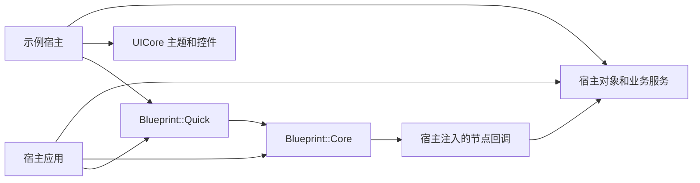

# 通用节点图与蓝图框架设计

BlueprintFramework 是面向多个宿主项目的 C++17 / Qt 5 图形化编程框架。Core 提供图数据、编辑与运行契约，Quick 提供可嵌入的画布。TimelineControlApp 和独立 Demo 作为宿主注册自己的对象及节点，不将业务领域写入 Core。

本文说明工程边界和扩展接入方式；精确字段、所有权、变更和运行规则以[数据结构与变更通知](../BlueprintFramework/docs/data-model.md)及公共头文件为准。当前基线直接统一实现，不维护旧接口、旧节点别名或旧文件迁移。

## 开源实现与产品参考

| 参考 | 已核对的实现或功能 | 本框架的设计取舍 |
| --- | --- | --- |
| Unreal Engine 蓝图 | `UEdGraphSchema` 提供引脚连线判定，蓝图函数区分纯函数与通过执行引脚调用的函数。 | 统一连线判定入口，区分执行端口和数据端口。事件和动作按执行线推进，纯计算按需求值。[Schema API](https://dev.epicgames.com/documentation/en-us/unreal-engine/API/Runtime/Engine/UEdGraphSchema) · [蓝图函数](https://dev.epicgames.com/documentation/en-us/unreal-engine/functions-in-unreal-engine) |
| Blender 节点 | `bNodeTree` 保存节点和连线，连线记录两端节点与端口。端口有独立标识。 | 图文档集中拥有连线。固定端口用类型内稳定的键定位，名称和排列顺序可独立修改。[节点结构源码](https://github.com/blender/blender/blob/main/source/blender/makesdna/DNA_node_types.h) |
| QtNodes | `AbstractGraphModel` 可脱离 `QGraphicsScene` 和视图使用。其数据流模型另外实现输入变化和新连线引发的数据传播。 | 借鉴模型与视图的分工。编辑操作更新图文档，动作执行由明确的入口触发。[项目源码与说明](https://github.com/paceholder/nodeeditor#introduction) |
| Godot GraphEdit | 提供平移缩放、节点拖动与连线交互，并发出连接、断开及删除请求。 | 画布发出操作意图，文档决定是否接受并通知视图。拖线预览和正式连线分开处理。[GraphEdit API](https://docs.godotengine.org/en/stable/classes/class_graphedit.html#signals) |
| Node-RED | MQTT 输入、输出节点可共享一个配置节点。配置有自己的引用与生命周期。 | 让多个节点引用同一宿主资源。设备实例、连接和参数的所有权留在宿主。[配置节点文档](https://nodered.org/docs/creating-nodes/config-nodes) |
| Rete.js | 混合引擎示例在控制流到达节点时从数据流获取输入，然后推进执行。 | 同一图可包含两类端口。按需求值与动作结果分别管理。[混合处理指南](https://retejs.org/docs/guides/processing/hybrid/) |

这些参考用于明确职责，不要求复现其完整引擎或插件系统。

## 工程边界与共用能力



| 层次 | 当前共用能力 | 宿主提供的内容 |
| --- | --- | --- |
| Core 注册与声明 | 项目作用域内追加注册；参数、端口、属性和接口描述；值与约束校验。 | 类型 ID、具体声明及由节点配置派生的端口。 |
| Core 文档 | 图身份、节点与连线、原子编辑、提交后通知、JSON 和逻辑快照。 | 保存时机及对象引用的含义。 |
| Quick 编辑器 | 模型投影、节点和连线交互、共享撤销历史、默认节点库及参数面板。 | 主题、特殊节点内容、对象或成员选择器。 |
| Core 运行时 | 按端口需求值、顺序执行、异步结果校验、停止取消和实例隔离。 | 纯计算、业务动作、取消请求及实际外部服务。 |
| 宿主对象 | 不由框架复制或持有。 | 身份、配置、实时状态、生命周期和并发资源规则。 |

`Blueprint::Core` 只依赖 Qt Core。`Blueprint::Quick` 增加 Qt Quick 和 QuickControls2，仍不依赖 UICore。Demo 才使用 UICore；Core 和 Quick 可以独立导出安装，通过 `find_package(BlueprintFramework REQUIRED)` 链接。构建开关、源码接入和测试命令见 [README](../BlueprintFramework/README.md)。

静态对象图和可执行蓝图共用文档与编辑器。静态卡片可以零端口；是否运行以及从哪个执行输出触发由宿主决定。当前没有抽象图策略、通用消息总线或二进制扩展加载层。

## 数据模型与所有权

图文件只保存图 ID、节点 ID、类型、位置、参数覆盖和连线端点。声明、派生端口、宿主对象及运行状态各自有单一来源。

- 节点引用共享注册表中的不可变定义。打开文档后追加新类型可以立即用于该文档，不复制或手动刷新注册表。
- 参数定义描述持久化配置；属性定义描述宿主或运行对象的值；接口定义描述单次调用的输入和输出。三者复用基础值与约束声明。
- 执行类别与数据类型分开表达，执行端口不伪装成某种值类型。普通数据连线连接相同类型，转换由显式节点实现；`anyValueType` 仅用于静态数据输入，接受现有具体值类型并由节点实现判定实际类型语义。
- 读取成员保存目标和成员引用，端口类型从稳定成员声明推导；不再保存成员类型的镜像。
- `resolvePorts(const NodeData &)` 只依赖本节点配置和稳定声明。类型与端口变更在同一次文档提交中校验，已有连线不兼容时拒绝修改。
- 图实例只保存覆盖值，清除覆盖恢复定义默认值或未设置状态。输入默认值从端口声明解析，未连线时使用。
- 宿主对象通过模块约定的稳定引用定位。现阶段用声明过的字符串参数承载引用，不把设备指针、QML 对象或未实现的对象值类型写入图。

当前数据类型限定布尔、有限数值和字符串，参数另可限制候选值、数值范围和整数条件。自定义值类型与精确大整数尚未进入实现。

文档、会话和注册表在编辑器线程使用；注册表先于文档创建并晚于其销毁，文档晚于会话销毁。运行时读取文档线程创建的值快照。宿主服务的线程归属和存活期由注入方负责。

## 当前公共入口

```cpp
Diagnostic NodeRegistry::add(const NodeTypeDefinition &definition);
const NodeTypeDefinition *NodeRegistry::find(const QString &typeId) const;
QVector<NodeTypeDefinition> NodeRegistry::definitions() const;

Diagnostic GraphDocument::canConnect(const Endpoint &source, const Endpoint &target) const;
EditResult GraphDocument::addNode(const QString &typeId, QPointF position,
                                  QVariantMap parameters = {});
EditResult GraphDocument::setParameters(QUuid nodeId, const QVariantMap &values);
GraphSnapshot GraphDocument::snapshot() const;

Diagnostic GraphRuntime::start(const GraphSnapshot &snapshot,
                               const RuntimeImplementations &implementations);
ValueResult GraphRuntime::evaluate(const Endpoint &endpoint);
ExecutionResult GraphRuntime::execute(const Endpoint &executionOutput);
void GraphRuntime::stop();
```

`Diagnostic` 包含稳定代码、展示消息、节点 ID 和成员或端口键，空代码表示成功。编辑结果还包含受影响 ID 和冲突实例 ID。Quick 同时投影展示错误和结构化诊断，调用方不解析错误消息。

文档校验端点存在、方向、类别、类型、重复连线和连接数量。数据输入最多一个来源，执行输入可连接多个来源。两种输出都可连接多个输入，同一对端点只允许一条连线。运行时另校验快照和执行约束，实际求值时检查所需输入与实现。

编辑操作先校验再提交，提交后只通知一次，失败和无变化不递增 revision。删除节点及关联连线合成一次操作。批量参数更新、清除覆盖、派生端口变更都通过同一入口执行。撤销历史按文档共享，拖动只在释放时提交。节点模型与只读连线列表各自投影文档，几何和视口状态留在画布。

JSON 采用现行 `version: 1` 格式，加载临时数据并完整校验后替换，保存使用原子写入。未知类型、无效参数和不支持的版本返回诊断，并保留当前图。

## 扩展接入与外部对象

当前采用源码或静态库链接、宿主显式注册。一个扩展按需提供类型定义、QML 内容与运行回调，以同一稳定 `typeId` 关联。类型追加不修改已有定义；动态类型追加和动态加载 DLL 是两件事，后者尚未实现。

默认节点库和参数面板从正式声明生成，特殊展示才提供自定义组件。宿主服务注入运行回调，不放入图配置。接口声明描述能力，框架不自动反射或开放任意 `QObject` 成员。

设备用例可分为以下三个实际职责：

| 节点用法 | 图里保存什么 | 数据和执行来源 |
| --- | --- | --- |
| 对象卡片 | 稳定对象引用、图位置及展示配置。 | 宿主对象查询及属性通知。 |
| 读取成员 | 目标和属性引用。 | 属性声明确定类型，求值回调读取宿主当前值。 |
| 设置或调用 | 目标、成员或接口引用及节点配置。 | 执行到达时按声明校验输入，由宿主完成操作并报告结果。 |

Demo 的模拟音箱实现这一边界。卡片和多个操作节点可引用同一个音箱；删除卡片不删除音箱。播放与时长状态由宿主持有，属性改变刷新预览；播放请求完成通过动作完成回调推进。

Timeline 的真实设备接入仍属于宿主扩展工作。现有 `DeviceModel::deviceById` 可用于解析对象，`DeviceParamSpec::invalidReason` 与 `Device::setParamValue` 可作为宿主的校验和更新入口。接入时应复用这些实际约束并将其投影为框架成员声明，避免第二份设备配置。[设备查找](../App/runtime/devices/DeviceModel.cpp) · [设备参数](../App/runtime/devices/DeviceParamSpec.h) · [字段代理](../UICore_new/COMPONENT_GUIDE.md)

## 执行语义

启动时固定图身份、文档 revision、节点参数和已解析端口。编辑在下次启动时生效，宿主实时状态继续从宿主读取。数据依赖和执行流分别要求无环，不为循环加入隐式次数或递归深度限制。

纯求值接收参数和按输入端口键组织的值，返回完整输出端口表。需求值内复用上游结果，下一次求值重新读取实时状态；多输出始终以 `{nodeId, portKey}` 区分。

动作接收包含运行、执行和调用 ID 的 `ExecutionContext`。同步和异步动作使用同一个完成回调，完成可以来自任意线程。结果统一排队回运行线程，检查身份、执行出口和输出类型后才推进。数据依赖不自动执行动作，动作输出只有在本次执行完成该动作后可读，下次执行前清空。

一个运行实例同时受理一次执行，忙时显式拒绝；不同实例分别持有输出、执行位置和调用身份。每个执行端口最多一条连线，动作选择出口后沿该出口继续，每次只发起一个动作。非空诊断结束整次执行，成功动作可选择声明的出口或结束当前分支。

停止先清除运行和调用身份，再请求宿主取消当前请求。重复、停止后迟到、前一实例及对象销毁后的回调都不能推进执行。框架只保证停止后的执行隔离，外部请求是否实际撤回由宿主能力决定。

`executionFinished` 表达本次执行完成、失败或取消；实时属性变化独立走宿主通知。当前没有通用事件入队、变量表或逐节点调试事件。预览与正式执行使用不同实例，运行可脱离画布进行。

## 验证与后续范围

| 验证层次 | 当前检查 |
| --- | --- |
| 文档和 Quick 投影 | 动态注册、不可变声明、参数约束、原子批量修改、清除覆盖、派生端口、撤销及保存加载。 |
| 无界面运行 | 多输出、共享依赖、输入默认值、启动快照和宿主实时读取、结果类型、无环约束、忙状态。 |
| 异步生命周期 | 失败、跨线程完成、重复完成、停止取消、重启后迟到结果、实例隔离及销毁后回调。 |
| 示例宿主 | 常量和加法编辑、对象卡片、成员读写、异步模拟播放、文件和共享编辑状态。 |
| 第三方构建 | Core 独立构建、Core/Quick 安装导出和包引用；Demo 单独保留 UICore 依赖。 |

后续仅按实际用例引入自定义值类型、循环、并行动作、事件队列、变量、子图、执行调试和二进制插件生命周期。当前公共接口不为这些能力加入空实现、兼容层或预留配置。

性能验证使用固定图和目标机器上的 Release 构建，记录节点数、可见项、控件数、加载时间、内存和拖动帧时间。可以用 100 与 500 节点作为测量样本；按分析结果决定是否进行画布外节点按需实例化或 C++ 场景图批量绘制。当前交付不包含这些优化及性能承诺。[Qt Quick 性能建议](https://doc.qt.io/qt-5/qtquick-performance.html)
