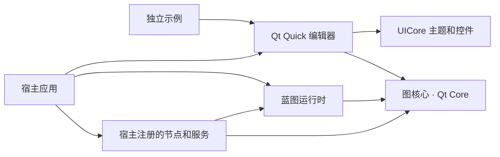

# 通用节点图与蓝图框架设计

本设计面向独立的 C++17 / Qt Quick 工程。框架支持静态对象的展示与编辑，也支持由事件驱动的蓝图执行。`TimelineControlApp` 是接入方，负责注册设备相关节点并提供设备服务。当前接入基线为 Qt 5.14 和 `UICore_new`。

## 开源实现与产品参考

| 参考 | 已核对的实现或功能 | 本框架的设计取舍 |
| --- | --- | --- |
| Unreal Engine 蓝图 | `UEdGraphSchema` 提供引脚连线判定，蓝图函数区分纯函数与通过执行引脚调用的函数。 | 统一连线判定入口，区分执行端口和数据端口。事件和动作按执行线推进，纯计算按需求值。[Schema API](https://dev.epicgames.com/documentation/en-us/unreal-engine/API/Runtime/Engine/UEdGraphSchema) · [蓝图函数](https://dev.epicgames.com/documentation/en-us/unreal-engine/functions-in-unreal-engine) |
| Blender 节点 | `bNodeTree` 保存节点和连线，连线记录两端节点与端口。端口有独立标识。 | 图文档集中拥有连线。固定端口用类型内稳定的键定位，名称和排列顺序可独立修改。[节点结构源码](https://github.com/blender/blender/blob/main/source/blender/makesdna/DNA_node_types.h) |
| QtNodes | `AbstractGraphModel` 可脱离 `QGraphicsScene` 和视图使用。其数据流模型另外实现输入变化和新连线引发的数据传播。 | 借鉴模型与视图的分工。编辑操作更新图文档，动作执行由明确的入口触发。[项目源码与说明](https://github.com/paceholder/nodeeditor#introduction) |
| Godot GraphEdit | 提供平移缩放、节点拖动与连线交互，并发出连接、断开及删除请求。 | 画布发出操作意图，文档决定是否接受并通知视图。拖线预览和正式连线分开处理。[GraphEdit API](https://docs.godotengine.org/en/stable/classes/class_graphedit.html#signals) |
| Node-RED | MQTT 输入、输出节点可共享一个配置节点。配置有自己的引用与生命周期。 | 让多个节点引用同一宿主资源。设备实例、连接和参数的所有权留在宿主。[配置节点文档](https://nodered.org/docs/creating-nodes/config-nodes) |
| Rete.js | 混合引擎示例在控制流到达节点时从数据流获取输入，然后推进执行。 | 同一图可包含两类端口。先做按需求值与执行结果隔离，按实测决定缓存粒度。[混合处理指南](https://retejs.org/docs/guides/processing/hybrid/) |

以上是设计参考。模块边界和接口为本工程的提案，需用独立示例验证。

## 工程边界与共用能力



工程提供独立的 CMake 入口。先交付图核心、编辑器和示例，第二阶段加入可单独链接的运行时。UICore 由宿主或独立示例提供，编辑器复用其主题、控件和表单能力。核心及运行时可脱离 QML 引擎构建和验证。

| 职责 | 共用能力 | 使用方提供的内容 |
| --- | --- | --- |
| 图核心 | 节点类型注册、文档、稳定标识、基础校验、保存与加载 | 节点类型及参数、端口声明 |
| 编辑器 | 节点与连线显示、选择、拖动、平移缩放、编辑操作、撤销重做、通用属性面板 | 按需提供节点外观、字段控件、对象选择器及数据绑定 |
| 运行时 | 构建运行快照、事件调度、求值、变量、等待与取消、诊断 | 事件来源、业务动作与业务服务 |
| 宿主 | 管理项目、资源、保存时机和业务对象生命周期 | 设备、素材、时间线或其他领域对象 |

静态对象图和可执行蓝图共用一套图文档与编辑器。静态节点可以零端口，可以持有图内参数，也可以引用宿主对象。需要执行时，由运行时独立检查图的入口、数据依赖和行为注册。同一可执行图也可以包含作为数据来源的对象引用节点。首版用这些约束覆盖两种场景，等实际出现不同的连线规则或求值模型时再引入图类型策略。

## 数据模型与所有权

| 数据 | 最小内容 | 生命周期 |
| --- | --- | --- |
| `NodeTypeDefinition` | 稳定类型 ID、名称、参数定义、固定端口定义 | 由宿主或内置节点包注册，供文档查询 |
| `PortDefinition` | 稳定键、方向、类别、数据类型、连接数量规则、可选默认值 | 随节点类型定义 |
| `NodeData` | 节点 ID、类型 ID、参数覆盖值、可选输入默认值、画布位置 | 图文档持有 |
| `ConnectionData` | 连线 ID、源和目标的 `{nodeId, portKey}` | 图文档持有，端口邻接表由连线派生 |
| `GraphDocument` | 格式版本、图 ID、节点与连线。需要变量和事件时再加入相应声明 | 用户编辑和保存 |
| 编辑器状态 | 选择、悬停、拖动预览与视口 | 每个打开的视图持有，同一文档的编辑视图共享撤销历史 |
| 运行实例和执行上下文 | 实例变量、事件队列。本次事件参数、输出、执行位置、异步等待 | 运行时持有，独立于文档 |

节点 ID、类型 ID 和宿主对象 ID 各自有独立的含义。端口连接使用稳定键，如 `lhs` 或 `completed`。输入默认值只在无连接时使用，参数用于配置节点自身，执行结果属于单次执行。默认值和参数由定义约束，实例只保存覆盖值。第一阶段支持固定端口，实例级动态端口有实际用例时再加入自己的稳定标识。

数据端口从布尔、整数、数值、字符串开始。定义声明类型，值可通过 `QVariant` 承载，校验和文件编码按声明类型处理。首版只连接同类型端口，转换通过显式转换节点表达。需要跨端口传递业务对象时，用包含对象类型与稳定 ID 的引用值，由宿主解析。需要持久化 64 位整数时显式定义无损 JSON 编码。

文档是图拓扑的唯一来源。QML 只通过列表模型和角色读数据，通过统一入口提交编辑。节点的屏幕坐标、拖动中的临时位移和高亮由编辑器计算。运行时读取启动时的逻辑快照，同一次运行的拓扑和参数保持一致。

## 接口草案

下列是边界签名，类型名可在实现时根据代码收敛。`EditResult` 包含成功状态、受影响的 ID，以及失败时的诊断。应用与 QML 共享校验结果，诊断可定位到节点或端口。

```cpp
// 图核心。注册时拒绝重复类型 ID 和同类型中的重复端口键。
RegistrationResult NodeRegistry::add(NodeTypeDefinition definition);
const NodeTypeDefinition *NodeRegistry::find(const QString &typeId) const;

// 图文档。查询连线用于拖线预览，提交时再次校验。
ConnectionCheck GraphDocument::canConnect(const Endpoint &from,
                                          const Endpoint &to) const;
EditResult GraphDocument::addNode(const QString &typeId, QPointF position);
EditResult GraphDocument::moveNode(const NodeId &node, QPointF position);
EditResult GraphDocument::setParameter(const NodeId &node, const QString &key,
                                       const QVariant &value);
EditResult GraphDocument::connectPorts(const Endpoint &from, const Endpoint &to);
EditResult GraphDocument::removeConnection(const ConnectionId &connection);
EditResult GraphDocument::removeNode(const NodeId &node);
IoResult GraphDocument::loadFile(const QString &path);
IoResult GraphDocument::saveFile(const QString &path) const;

// 编辑器扩展。默认按参数定义生成控件，按类型注册的 QML 组件可覆盖展示。
void EditorRegistry::setNodeDelegate(const QString &typeId, const QUrl &component);
void EditorRegistry::setPropertyEditor(const QString &typeId, const QUrl &component);

// 运行阶段加入。可按节点类型分别注册纯计算或动作实现。
void RuntimeRegistry::registerEvaluator(const QString &typeId, Evaluator evaluate);
void RuntimeRegistry::registerAction(const QString &typeId, Action execute);
StartResult GraphRuntime::start(const GraphDocument &document);
EnqueueResult GraphRuntime::postEvent(const QString &eventId, const QVariantMap &payload);
void GraphRuntime::stop();
```

文档校验包括端点存在、方向、端口类别、类型、重复连线和连接数量。默认每个数据输入只接一个来源，输出可连接多个输入。遇到占用的输入，首版返回错误，替换连线可以后续作为一个可撤销操作接入。运行时另外检查入口签名、所需输入、节点实现以及执行和数据依赖。首版可执行子图使用无环约束，循环节点有单独的语义需求时再加入。

编辑器可用节点、连线两个 `QAbstractListModel` 投影文档，按行和角色通知变化。节点角色提供 ID、类型、位置和需要展示的数据，连线角色提供两端 ID 与端口键。QML 节点组件通过端口键提供锚点，画布将其转换到同一坐标系。每次拖动在释放时提交一次位置修改，节点删除与删除关联连线合成一次操作。撤销历史按文档管理，同一文档的多个视图共享。自定义属性面板提交设备属性时调用宿主的修改入口，由宿主管理设备配置保存和撤销。详见[数据与图的对应关系](../BlueprintFramework/docs/data-model.md#数据与图的对应关系)。

JSON 记录稳定 ID、参数、端点和布局。先将文件读入临时文档并校验，再替换当前文档。保存采用原子写入。首版遇到未知类型或不支持的格式版本时返回可定位的错误并保留当前文档。出现可选扩展后，再实现保留未知节点数据与关联线的占位显示。升级文件版本与迁移节点参数分别处理，等出现首个实际格式或节点升级再实现迁移逻辑。

## 扩展接入与设备用例

先采用编译期链接、宿主启动时显式注册。一个扩展按需提供节点类型定义、展示组件、属性编辑器和执行行为。各注册表以同一个稳定 `typeId` 关联，例如 `timeline.device.config`。已注册的类型定义在文档和运行实例使用期间保持稳定。核心只使用节点定义，编辑器和运行时各取自己所需的注册项。自定义组件接收节点信息和编辑入口。设备服务由宿主注入对应的编辑器组件或执行行为，作用域跟随项目或运行实例。

设备扩展可以注册三种相互独立的用法：

| 节点类型示例 | 图里保存什么 | 如何工作 |
| --- | --- | --- |
| `timeline.device.config` | 设备引用和卡片布局，可选的展示字段键 | 静态配置节点，通过设备 ID 找到对象。卡片和属性面板编辑同一份参数。 |
| `timeline.device.reference` | 设备引用 | 蓝图中的数据节点，提供有类型的设备引用供其他节点使用。 |
| `timeline.device.command` | 动作选项和输入端口的配置 | 执行到达后使用输入设备引用调用宿主，按完成或失败选择执行出口。 |

上表是职责示例。若实际产品需要同一个设备节点既能展示配置又能提供对象输出，可注册一个类型并为它补上输出端口和求值行为。

当前项目可从 `DeviceModel::deviceById` 解析设备。`DeviceParamSpec` 已继承 `UICore::BaseField`，属性面板可通过 `AppField.sourceField` 读取同一个字段。提交时由宿主按 `DeviceParamSpec::invalidReason` 等现有规则校验，再调用 `Device::setParamValue`。设备删除时，卡片显示引用失效，用户可重新绑定或移除。图节点被删除时只删除该图中的表示，设备生命周期由宿主控制。[设备查找](../App/runtime/devices/DeviceModel.cpp) · [设备参数](../App/runtime/devices/DeviceParamSpec.h) · [字段代理](../UICore_new/COMPONENT_GUIDE.md)

## 执行语义

求值接口接收只读节点参数和已解析的数据输入，返回按输出端口键组织的数据或诊断。动作接口另外接收触发的执行入口和本次调用上下文，完成时报告所选执行出口、输出值或失败原因。宿主动作可把完成回调与异步设备请求关联，运行时负责检查声明的端口和结果类型，再提交结果与推进执行。

1. **启动和事件**。每个图运行实例持有一份已校验的逻辑快照和自己的变量表。事件声明包含稳定 ID 与参数类型。外部事件进入实例队列，同一实例按顺序处理。不同实例的异步操作可以交错进行，设备资源的互斥由宿主保证。
2. **数据读取**。纯计算按需读取输入。一轮求值内可复用结果，下一步重新读取依赖可变状态的值。变量写入后，下一次读取可看到新值。需要观察实际设备状态的 I/O 作为显式动作，结果写入本次执行上下文。
3. **动作结果**。同步动作直接返回结果，异步动作通过完成回调报告出口、数据和错误。框架校验结果后再推进。某个动作的结果只有在该动作于本次执行完成后才可读取。失败可走声明的失败出口，否则结束本次执行并记录诊断。
4. **取消**。等待与运行实例、执行 ID 和节点调用绑定。停止实例时清理队列并请求取消等待，迟到结果通过调用标识过滤。回调投递回运行实例所属线程。已发出的外部命令由宿主按能力处理。
5. **调试**。运行时发布按图实例和节点 ID 定位的开始、等待、完成、失败事件。编辑器订阅可见图并显示节点或连线状态。运行可脱离画布继续进行。

## 开发顺序与验收

| 阶段 | 交付 | 验收 |
| --- | --- | --- |
| 1. 图编辑 | 独立 C++ 核心、QML 画布、注册、属性编辑、类型连线、撤销、JSON | 在示例中创建 `常量 → 加法 → 结果`，移动、编辑、撤销、保存重开。错类型和占用端口能给出原因。另注册一个零端口的示例资源节点，验证静态对象显示与编辑。 |
| 2. 最小执行 | 事件入口、布尔和数值求值、条件分支、变量、延时、停止、状态通知 | 无 QML 运行 `事件 → 比较 → 分支 → 延时 → 设变量`。验证两实例互不影响、同实例事件有序，以及停止后旧回调无法推进。 |
| 3. 宿主接入 | TimelineControlApp 设备配置与命令扩展 | 同一设备在原页面、画布卡片和属性面板显示一致。流程通过设备引用执行动作。验证设备删除、重新绑定及保存后恢复。 |
| 4. 按实际使用完善 | 复制粘贴、搜索、分组、注释、动态端口、子图及调试工具按需求增加 | 每项以实际使用场景验收。子图优先定义外部端口和调用语义。动态加载只在存在独立发布扩展的需求时进入设计。 |

第一阶段先写最小的 C++ 定义、文档和连线检查，再立即接一版 QML 画布验证。编辑闭环优先验证两种类型的节点共用编辑入口，以及布局和连线在保存恢复后仍可定位。

性能验收使用固定图和目标机器上的 Release 构建。第一轮可用 100 与 500 个节点作为测量样本，记录可见项、编辑控件数、加载时间、内存和拖动时帧时间。默认用轻量节点摘要，选中或编辑时再加载复杂字段。拖动只改变预览和相连线的几何，模型只发局部通知。画布范围外的节点按规模考虑按需实例化。连线先使用简单绘制层，出现瓶颈后通过分析结果决定是否改用 C++ 场景图批量绘制。[Qt Quick 性能建议](https://doc.qt.io/qt-5/qtquick-performance.html)
